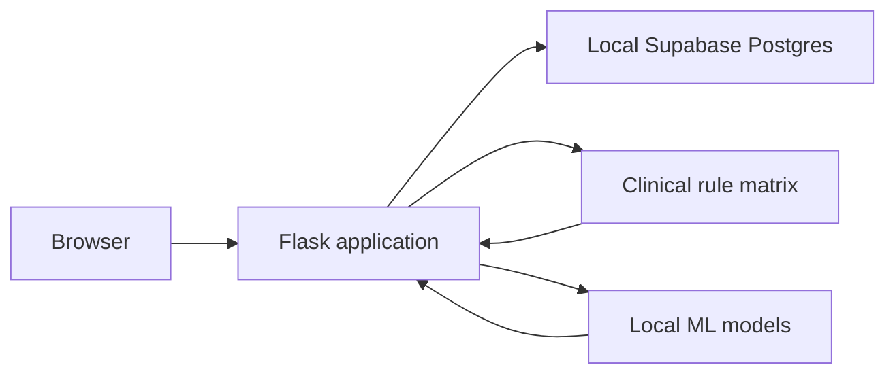

# Supabase Migration Plan

## 1. Current-State Summary

DiaBeates is a Flask application for diabetes-complication risk screening for patients, caregivers, and clinicians. It uses local Python clinical rules and four serialized ML models.

Confirmed components:

- [app.py](../app.py): Flask routes, authentication, sessions, persistence calls, security controls.
- [database.py](../database.py): SQLCipher SQLite connection, schema, migrations, retention, ownership checks.
- [rule_matrix.py](../rule_matrix.py): clinical rule scoring.
- [clinical_model.py](../clinical_model.py): ML inference.
- [recommendations.py](../recommendations.py): recommendations.
- [validation.py](../validation.py): server-side validation.
- [wsgi.py](../wsgi.py): Waitress entry point.
- [Dockerfile](../Dockerfile), [docker-compose.yml](../docker-compose.yml): container deployment.

Current database engine: SQLCipher-encrypted SQLite, hosted locally. It uses WAL mode, foreign keys, additive schema migrations, and Windows DPAPI-backed key storage. The database file is `diabetes_system.db`; runtime key sources are `DIABEATES_DB_KEY`, `.db.key.dpapi`, and the legacy `.db.key` migration path.

Confirmed tables:

- `assessments`
- `risk_results`
- `lab_assessments`
- `feedback`
- `users`
- `password_reset_tokens`
- `audit_log`

No repository-defined views, triggers, or stored procedures were found. Runtime data size and production row counts are UNKNOWN.

Authentication is custom Flask-Login with Werkzeug password hashes, optional accounts, roles, lockout state, and SMTP password reset. File uploads were not found. Clinical data is sensitive health data. Flask is the application data layer and local inference remains in Python.

## 2. Target Architecture

The approved direction is a gradual move to local Supabase Postgres, with Flask as the only data layer. The browser will not connect to Supabase.

Use local Supabase CLI and Docker for development and testing. Hosted staging and production actions are human-run checklists only.

Required:

- Supabase local Postgres
- Versioned SQL migrations
- Deny-by-default RLS on every public table
- Revoked `anon` and `authenticated` table privileges
- Server-side Postgres connection pooling for multi-threaded Waitress

Not required initially:

- Supabase Auth
- Storage
- Realtime
- Edge Functions

Retention pruning must be replaced with a scheduled job or `pg_cron`; the exact deployment choice is UNKNOWN for local and hosted environments.

For IPv4-only networks, document the distinction between direct database connection strings and pooler connection strings. The selected local and hosted connection mode remains UNKNOWN until deployment constraints are confirmed.

## 3. Schema Mapping

Use lowercase snake_case names and preserve existing IDs as `bigint generated by default as identity`. Use `timestamptz` normalized to UTC, `double precision` for BMI and lab values, and `boolean` for flags.

Tables:

- `assessments`: preserve assessment ID, guest `session_id`, nullable account ownership, timestamps, rule version, archive state, clinical intake fields.
- `risk_results`: preserve child IDs and assessment relationship; index `assessment_id`; enforce one row per `(assessment_id, category)` if confirmed.
- `lab_assessments`: preserve child IDs and optional lab values; use `double precision`; likely one row per assessment.
- `feedback`: preserve assessment relationship, boolean helpful flag, comment, timestamp.
- `users`: preserve local account IDs, email, password hash, display name, role, activation, timestamps, lockout fields, and consent fields.
- `password_reset_tokens`: not migrated; invalidate existing tokens at cutover.
- `audit_log`: preserve actor, action, target, IP, and UTC timestamp.

Foreign keys, indexes, nullability, role checks, category checks, and uniqueness constraints must be represented in migrations after confirming source data.

## 4. Data Migration Strategy

Use a read-only SQLCipher source. Inventory first, then export, transform, load, and validate in dependency order:

1. Schema.
2. `users`.
3. `assessments`.
4. `risk_results`.
5. `lab_assessments`.
6. `feedback`.
7. `audit_log`.

Preserve IDs. Normalize timestamps to UTC. Convert integer flags to booleans. Use per-column checksums, row counts, child counts, foreign-key checks, and clinical-value equality samples covering recent, archived, guest, claimed, with-labs, and without-labs records.

If inventory confirms a small dataset, use a one-shot migration with a short write freeze. Do not implement shadow writes or dual reads without explicit approval. Large-table batching and `COPY` are fallback options.

## 5. Security & Access Control

Flask remains the only data access layer. Ownership checks by `user_id` and `session_id` remain enforced in Python.

Enable RLS on every public table with no permissive policies. Revoke table privileges from both `anon` and `authenticated`. Add tests proving those roles cannot read data. The server-side application connection receives only the privileges it needs.

Never expose database credentials or service keys to the browser. Do not commit `.env`, keys, databases, dumps, exports, or patient data. Health data must be encrypted in transit, access-controlled, retained only as required, and excluded from logs.

Hosted region, data residency, privacy approval, and Free-plan suitability are UNKNOWN and require human approval.

## 6. Authentication Plan

This migration keeps Flask authentication and the `users` table, including password hashes. Supabase Auth is explicitly out of scope for this run.

Do not migrate `password_reset_tokens`; invalidate existing tokens at cutover. Existing SMTP behavior remains until separately changed.

Guest-session claiming remains an application-layer operation and must be tested against the Postgres repository.

## 7. Application Code Changes

Keep SQLite as the default backend and add `DB_BACKEND=sqlite|postgres`. SQLite behavior must remain unchanged for `sqlite`.

Expected changes:

- [database.py](../database.py) or a new persistence module: repository interface, SQLite implementation, Postgres implementation, pooling, transactions, and backend selection.
- [app.py](../app.py): use repository functions without changing clinical logic; preserve Flask authentication and ownership behavior.
- [requirements.txt](../requirements.txt): proposed `psycopg` 3 and `psycopg_pool`; approval is required before adding dependencies.
- [.env.example](../.env.example): document backend and non-secret connection variable names only.
- [docker-compose.yml](../docker-compose.yml): local configuration only after dependency and stack approval.
- Tests: shared parity tests for both backends, synthetic data only.

Do not modify [rule_matrix.py](../rule_matrix.py), [clinical_model.py](../clinical_model.py), [validation.py](../validation.py), or [recommendations.py](../recommendations.py).

## 8. Environments & Workflow

Use the Supabase CLI and Docker local stack only for development and testing. Run `supabase init`, keep SQL migrations in `supabase/migrations/`, and use local `supabase start`/`supabase db reset` only after approval for destructive commands.

Hosted staging and production are human-action checklists. They must not be accessed by this implementation.

Waitress is multi-threaded, so use a bounded Postgres pool. Document direct versus pooler connection strings and IPv4-only behavior. Add CI checks for migrations, schema/RLS tests, Python tests, secret scanning, and health checks.

## 9. Testing & Verification

Run the existing baseline suites before changes. Then add:

- schema and migration tests;
- deny-by-default RLS and privilege tests;
- repository parity tests for SQLite and Postgres;
- ownership, guest claim, archive, delete, retention, and timestamp tests;
- synthetic migration validation;
- basic performance and concurrency smoke tests.

Acceptance requires unchanged clinical outputs, complete row and child counts, zero foreign-key violations, preserved IDs and clinical values, correct ownership isolation, and a tested rollback.

## 10. Rollout & Rollback

Development rollout is local-only:

1. Inventory source.
2. Create local schema.
3. Test repository parity.
4. Run synthetic migration.
5. Validate and smoke-test.

For a small real dataset, use a short write freeze and one-shot load after human approval. Keep SQLite as rollback source. On failure, stop Postgres writes, restore `DB_BACKEND=sqlite`, and preserve validation evidence.

Hosted rollout checklist only:

- confirm region and plan;
- obtain privacy approval;
- configure secrets;
- schedule backups;
- run final export and validation;
- execute go/no-go review;
- cut over;
- retain a tested rollback path.

## 11. Risks & Mitigations

| Risk | Likelihood | Impact | Mitigation |
|---|---:|---:|---|
| Incorrect ownership mapping | Medium | Critical | Preserve Python checks and test guest/account isolation |
| RLS or grants accidentally permit access | Medium | Critical | No policies, revoke `anon`/`authenticated`, negative tests |
| Clinical values change type or precision | Low | Critical | `double precision`, checksums, equality samples |
| Password-reset tokens remain usable | Medium | High | Explicitly invalidate at cutover |
| Pool exhausted under Waitress threads | Medium | High | Bounded `psycopg_pool`, timeouts, concurrency test |
| Database size exceeds one-shot assumptions | Unknown | High | Inventory gate before selecting migration method |
| Local stack unavailable | Medium | High | Verify Docker and Supabase CLI before Phase 1 |
| Hosted privacy or region is unsuitable | Unknown | Critical | Human approval before hosted use |
| Secrets or patient data committed | Low | Critical | `.gitignore`, secret scan, synthetic tests only |
| Retention job is absent | Medium | High | Implement and test scheduled pruning replacement |

## 12. Phased Task Checklist

### Phase 0 — Baseline and inventory

- Read this plan and inspect repository state.
- Verify Git, Docker, and Supabase CLI.
- Run existing baseline tests and record exact results.
- Add a read-only inventory script.
- Run inventory only when the database key is available through the environment.
- Definition of done: tools verified, baseline recorded, inventory script reviewed, and unknowns reported.

### Phase 1 — Local Supabase foundation

- Initialize Supabase locally.
- Add versioned migrations for all in-scope tables.
- Add indexes, foreign keys, and checks.
- Enable deny-by-default RLS on every public table.
- Revoke `anon` and `authenticated` privileges.
- Add schema and negative-access tests.

### Phase 2 — Repository adapter

- Obtain approval for `psycopg` 3 and `psycopg_pool`.
- Add backend switch with SQLite default.
- Implement pooled Postgres repository.
- Add shared parity tests.

### Phase 3 — Migration tooling

- Build idempotent read-only export/transform/load tooling.
- Preserve IDs and dependency order.
- Generate validation report with counts, checksums, FK checks, and clinical samples.

### Phase 4 — Verification

- Run baseline suites on both backends.
- Run RLS, ownership, retention, timestamp, archive/delete, and guest-claim tests.
- Run performance/concurrency smoke tests.

### Phase 5 — Cutover and rollback documentation

- Write local cutover, go/no-go, rollback, backup, and hosted human-action runbooks.
- Document `pg_dump` schedule for human execution.
- Do not access hosted or production projects.

### Phase 6 — Supabase Auth

Out of scope. Requires separate explicit approval.

## 13. Assumptions & Open Questions

Confirmed:

- Gradual migration alongside SQLite.
- Local pilot.
- Flask remains the only data layer.
- Existing Flask authentication remains in this run.
- Local Supabase CLI and Docker only.
- SQLite remains the default backend.
- Shadow writes and dual reads require explicit approval.

Open questions:

1. What are the real database row counts and file size?
2. Is `DIABEATES_DB_KEY` available in the environment for inventory?
3. Are Docker Desktop and the Supabase CLI installed and working?
4. Which exact Postgres connection mode is required for local testing?
5. What pool size and concurrency target should be used?
6. Which scheduled retention mechanism should hosted deployment use?
7. Which hosted region and plan will receive human approval?
8. What downtime is acceptable for a one-shot cutover?
9. How long should SQLite be retained for rollback?
10. Is shadow-write/dual-read ever approved?
11. What backup cadence and retention are required?
12. What privacy, residency, and legal approvals are required?

### Discovery limitations

The repository does not establish actual production row counts, database size, hosted deployment details, Supabase region, privacy approval, external integrations, or whether the local database contains production health data.
